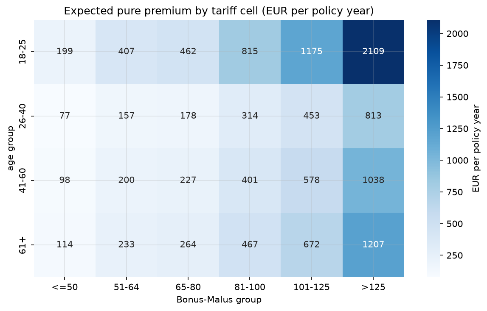
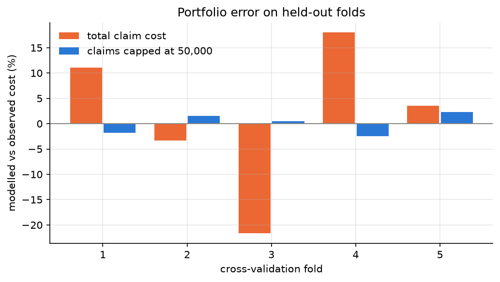

[🇬🇧 English](README.md) | [🇩🇪 Deutsch](README_DE.md)

# Insurance Pricing Analytics — motor liability tariff with Python and SQL

A pricing project on a public French motor third-party liability portfolio (freMTPL2):
claim frequency and claim severity are modelled separately with GLMs, combined into a pure
premium per tariff cell and validated out-of-sample. Python for the models, SQL for data
quality checks and portfolio analyses.

**The story in one sentence:** my first model overestimated the portfolio claim cost by 32% —
I traced this to the data, not the model: claim counts and claim amounts did not describe the
same claims.

👉 **Quick look:** [`insurance_pricing_walkthrough.ipynb`](insurance_pricing_walkthrough.ipynb)
tells the whole project with results and plots (rendered directly on GitHub).

---

## Key results

| | Result |
|---|---|
| **Data consistency** | The first model was **+31.9%** off on portfolio level. Cause: a block of 9,387 claim-only policies at the start of the data holds 27.5% of all claim counts but only 3% of them have a claim amount. After cleaning, frequency and severity count the same 26,065 claims. |
| **Out-of-sample** | Base tariff (age × Bonus-Malus): Gini **0.254**, deviance explained D² 3.99% on a held-out test set. Extended tariff with factors selected by cross-validation: Gini **0.289**, D² 4.68%. |
| **Large losses** | The 3 largest claims (all drivers aged 18–20) carry 11.5% of the total claim amount. With claims capped at €50,000, the severity effect of young drivers disappears (age factors 0.92–0.96, not significant). On 5 held-out folds the portfolio error ranges from **−22% to +18%** with all claims, but only **−2.5% to +2.3%** with capped claims. |
| **Severity model** | Gamma GLM vs. lognormal (with bias correction σ²/2): weighted error of the group means 1.1% vs. 14.6% (age groups). The lognormal model has smaller p-values — significance is not the same as a good estimate of the mean. |

<p align="center">
  
  
</p>

*Left: pure premium per tariff cell (EUR per policy year). Right: one single €4 million
claim moves the portfolio check of a fold by about 20 percentage points — the reason for
capping large claims and charging the excess as a loading.*

---

## Data

freMTPL2 from the R package CASdatasets, French motor third-party liability:

- `freMTPL2freq`: 678,013 policies with exposure, claim count and rating factors
  (driver age, Bonus-Malus, vehicle power / age / brand / fuel, area, density, region)
- `freMTPL2sev`: 26,639 claim amounts, linked by policy ID

French Bonus-Malus: 50 is the best value (0.5 × base premium), 100 the starting level,
above 100 a malus after claims.

## Method

| Step | What and why | Where |
|---|---|---|
| 1. Data quality | Claim counts vs. claim amounts per policy; a window function locates the inconsistent block; claims without a policy belong to only 6 policy numbers with 21–66 claims each; 7 of 9 policies with more than 4 claims share one driver profile (fleet-like). | `data_prep.py`, SQL ch. 1 |
| 2. Cleaning | Remove the whole block (removing only its claim policies would bias the frequency down), remaining inconsistent and fleet-like policies, cap exposure at 1 year. Implemented in Python and SQL, cross-checked policy by policy. 1.4% of policies and 2.6% of the claim amount removed. | `data_prep.py`, SQL ch. 2, `check_sql_cleaning.py` |
| 3. Frequency | Poisson GLM, log link, `log(Exposure)` as offset. | `frequency.py` |
| 4. Severity | Gamma GLM (log link) vs. lognormal model with bias correction. | `severity.py` |
| 5. Tariff | Pure premium = frequency × severity for 24 cells (4 age × 6 Bonus-Malus groups). | `pricing.py` |
| 6. Validation | 80/20 split with fixed seed; out-of-sample Poisson deviance vs. null model, lift chart, Gini; Negative Binomial overdispersion test; large-loss capping at €50,000; 5-fold cross-validation of the portfolio error. | `validation.py` |
| 7. Rating factors | Forward selection by 5-fold CV **on training data only** (gain ≥ 0.1% in every fold), test set used once; large-loss loading uniform vs. credibility-weighted; tariff tables averaged over the portfolio mix. | `features.py` |
| SQL | Indexes and query plans, data quality, cleaned tables with primary / foreign keys in a transaction, views for the rating bands, window functions (RANK, ROW_NUMBER, LAG, moving frames, PERCENT_RANK, NTILE, Gini via Lorenz curve). | `policies_analysis.sql` |

## Selected findings

- **The in-sample portfolio check proves consistency, not quality.** After cleaning, the
  portfolio error is −0.79% — almost by construction, because a Poisson GLM with log link
  reproduces the total claim count on its own training data. Predictive quality is measured
  out-of-sample.
- **Overdispersion is significant but small.** Negative Binomial α = 0.87 (LR test
  p ≈ 10⁻⁷⁸ thanks to the sample size), but the variance is only about 7% above Poisson at a
  typical frequency, and the tariff factors hardly change: overdispersion affects standard
  errors, not premiums.
- **Bonus-Malus predicts how often, not how expensive.** Claim frequency rises more than
  eightfold from the best to the worst class; capped claim amounts hardly change.
- **Factors are conditional.** At equal Bonus-Malus, drivers aged 21–30 have *lower*
  frequency factors than 41–50: for young drivers Bonus-Malus 100 is the starting level, for
  older drivers it means past claims. An age × Bonus-Malus interaction is the natural next step.
- **Credibility for large losses.** Spreading the large-loss excess uniformly gives every
  policy +29.6%; by age group alone it would be +157% for 18–25, based on only 14 large
  claims. Credibility weighting (Z = √(n/1082)) gives a defensible middle: +44.8% for 18–25.

## Limitations and next steps

- Age × Bonus-Malus interaction; a separate model for large-loss frequency.
- The inconsistent data block, the six missing policy numbers and a Bonus-Malus of 50 at
  age 18 (impossible under the French rules for the driver's own record) would have to be
  clarified with the data provider.
- No dates in the data: no trend, no claims development, no time-based validation.
- Severity is hardly predictable with the available factors (out-of-sample D² 0.4% for
  capped claims).

## Project structure

```
├── main.py                  base tariff: runs steps 1-5, writes analyse_plots.pdf
├── data_prep.py             loading, SQLite export, consistency report, cleaning, rating bands
├── eda.py                   exploratory analysis of frequency and severity
├── frequency.py             Poisson GLM
├── severity.py              Gamma GLM vs. lognormal model
├── pricing.py               tariff table and in-sample validation
├── metrics.py               shared settings: split, deviance, Gini, lift, plot style
├── validation.py            out-of-sample validation, overdispersion, large losses
├── features.py              rating-factor selection, credibility, tariff tables
├── policies_analysis.sql    SQL: data quality, cleaning, portfolio metrics, window functions
├── run_sql.py               runs the SQL file statement by statement
├── check_sql_cleaning.py    compares SQL and Python cleaning
├── insurance_pricing_walkthrough.ipynb   the project as a notebook with results
├── figures/                 plots used in this README
├── analyse_plots.pdf, validation_plots.pdf, features_plots.pdf, tariff_tables.csv
└── data/                    freMTPL2freq.csv, freMTPL2sev.csv
```

## How to run

Python 3.11 or newer.

```
python -m venv .venv
source .venv/Scripts/activate      # Git Bash on Windows
# .venv\Scripts\activate           # PowerShell
# source .venv/bin/activate        # macOS / Linux
pip install -r requirements.txt

python main.py                     # base tariff, creates insurance.db for the SQL part
python validation.py               # out-of-sample validation (~15 s)
python features.py                 # rating-factor selection (~1 min)
python run_sql.py                  # SQL analysis
python check_sql_cleaning.py       # SQL vs. Python cleaning
```

To run the notebook: `pip install notebook`, then `jupyter notebook`
(run `validation.py` and `features.py` first; the notebook shows some of their figures).
Run all scripts from the project folder, the data paths are relative.

Tested with Python 3.13, pandas 3.1, numpy 2.5, statsmodels 0.15, scipy 1.18,
matplotlib 3.11, seaborn 0.13.

---

## About

Developed independently as part of self-directed study in actuarial science after an
M.Sc. in Mathematics.

*Transparency note:* I built the original analysis myself. The revision — the search for the
cause of the 32% deviation, out-of-sample validation, rating-factor selection, the SQL
revision and the restructuring into modules — was carried out with an AI assistant (Claude),
whose commits are marked as such in the history. I reviewed every step, verified the findings
against the data and decided on the approach; some findings, such as the six policy numbers
behind the unmatched claims, were my own.
