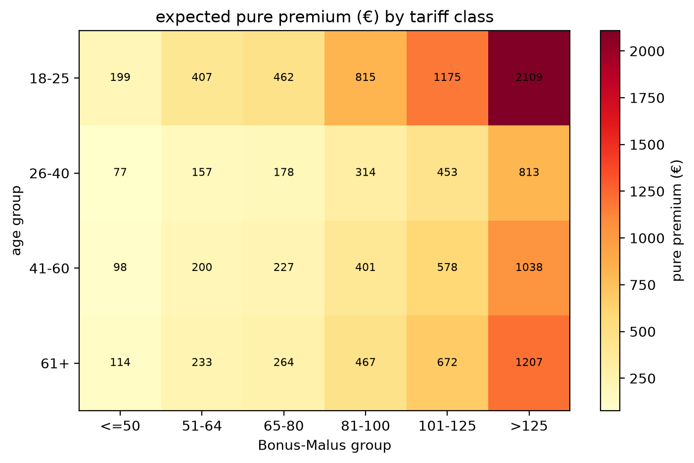

[🇬🇧 English](README.md) | [🇩🇪 Deutsch](README_DE.md)

# Über das Projekt

Dieses Projekt wurde eigenständig im Rahmen eines Selbststudiums in Aktuariat und Versicherungsmathematik nach dem Abschluss meines M.Sc. Mathematik entwickelt.

*Hinweis zur Transparenz:* Die Analyse habe ich selbst aufgebaut. Für ein späteres Review von Code und Ergebnissen habe ich einen KI-Assistenten (Claude) eingesetzt; jeden Befund daraus habe ich an den Daten nachgeprüft, alle Modellierungsentscheidungen sind meine eigenen.

# Insurance Pricing Analytics – Frequenz- und Schadenhöhenmodellierung mit Python

Ein Portfolio-Projekt, das einen vereinfachten aktuariellen Pricing-Workflow für die Kfz-Haftpflichtversicherung mit Python, SQL und statistischer Modellierung implementiert. Das Projekt folgt dem klassischen aktuariellen Ansatz, Schadenfrequenz und Schadenhöhe getrennt zu modellieren und alternative Severity-Modelle zu validieren.

## Projektüberblick

Dieses Projekt bildet die zentralen Schritte einer aktuariellen Pricing-Analyse nach:

- Datenaufbereitung mit Pandas und SQLite.
- Explorative Analyse eines Versicherungsportfolios und der Schadenhistorie.
- Modellierung der Schadenfrequenz mit einem Poisson-GLM.
- Modellierung der Schadenhöhe mit Gamma- und Lognormal-Modellen.
- Statistische Modellvalidierung und Modellvergleich.
- Ableitung aktuarieller Tarifrelativitäten für Pricing.

Das Projekt folgt der üblichen aktuariellen Trennung in **Frequency** (Wie häufig treten Schäden auf?) und **Severity** (Wie hoch sind die Schäden?).

## Technologien

- Python
- Pandas
- NumPy
- SciPy
- SQLite
- Statsmodels
- Matplotlib
- Seaborn
- VS Code

## Datensatz

Verwendet wird der öffentlich verfügbare Datensatz **French Motor Third-Party Liability (freMTPL2)**.

- `freMTPL2freq.csv` – Policeninformationen, Exposure und Schadenanzahl (678.013 Zeilen, 12 Spalten).
- `freMTPL2sev.csv` – Einzelne Schadenbeträge (26.639 Zeilen, 2 Spalten).

Beide Datensätze werden über die Policen-ID (`IDpol`) zusammengeführt.

### Datenkonsistenz und Bereinigung

Schadenanzahl (`ClaimNb`) und Schadenbeträge müssen dieselben Schäden beschreiben, sonst lässt sich *Frequenz × Schadenhöhe* nicht mit den beobachteten Schadenkosten vergleichen. Eine Konsistenzprüfung zeigt, dass das in den Rohdaten nicht gilt:

| Prüfung | Ergebnis |
|---------|---------:|
| Summe `ClaimNb` | 36.102 |
| Zeilen in `freMTPL2sev` | 26.639 (Verhältnis 1,355) |
| Schäden ohne zugehörige Police | 195 |

Die fehlenden Schadenbeträge sind **nicht** zufällig verteilt, sondern liegen fast vollständig in einem Block am Anfang des Datensatzes:

| | Block `IDpol < 24.952` | Restbestand |
|---|---:|---:|
| Policen | 9.387 (jede mit ≥ 1 Schaden) | 668.626 |
| Anteil Exposure | 1,3 % | 98,7 % |
| Anteil an allen `ClaimNb` | 27,5 % | 72,5 % |
| Schäden mit Schadenbetrag | 3 % | 99,9 % |
| Jährliche Schadenfrequenz | 2,07 | 0,074 |

Bereinigungsschritte:

Die 195 Schäden ohne zugehörige Police gehören zu nur **6 Policennummern mit je 21 bis 66 Schäden** (Policen mit Schaden haben sonst im Schnitt 1,06 Schäden). Die benachbarten Policennummern existieren im Policenbestand, es handelt sich also um Lücken in den Policendaten. Alle sechs liegen im Bereich 2.220.000–2.287.000, in dem auch 5 der 8 Policen mit 5–16 Schäden liegen (siehe Schritt 3). Das deutet auf Flotten oder Sammelverträge hin, die nicht als Einzelrisiken abgebildet sind.

1. Den Block komplett ausschließen (ganze Policen). Nur die Schadenpolicen ohne Betrag zu streichen würde die Frequenz nach unten verzerren, weil die schadenfreien Policen erhalten blieben.
2. Übrige Policen ausschließen, deren `ClaimNb` nicht zur Anzahl bezifferter Schäden passt.
3. Policen mit mehr als 4 Schäden ausschließen (8 Policen mit 5 bis 16 Schäden, überwiegend in 0,07–0,41 Versicherungsjahren und mit nahezu identischem Fahrerprofil; vermutlich Flotte oder Erfassungsfehler). Ausschließen statt Kappen hält Schadenzahl und Schadenbeträge konsistent.
4. Exposure auf 1 Jahr kappen (1.224 Policen).
5. Schäden ohne Police und Schäden ausgeschlossener Policen entfernen.

Nach der Bereinigung: **668.595 Policen, 353.540 Versicherungsjahre, 26.065 Schäden mit jeweils genau einem Schadenbetrag** (1,4 % der Policen und 2,6 % des Schadenaufwands ausgeschlossen). Der Block hat auch die Tarifstruktur verzerrt: Er enthält überdurchschnittlich viele Policen mit Bonus-Malus ≤50 und Fahrer ab 61. Nach der Bereinigung werden die Bonus-Malus-Relativitäten deutlich steiler (z. B. BM >125: 6,2 → 9,7).

## Projektstruktur

```text
insurance-pricing-analytics/
│
├── main.py               # vollständige Analyse Workflow
├── data_prep.py          # Laden, Konsistenzprüfung und Bereinigung der Daten
├── validation.py         # Out-of-sample-Validierung, Overdispersion, Großschäden
├── requirements.txt      # Python-Abhängigkeiten
├── queries.sql           # SQL Befehle für Portfolio Untersuchung
├── policies_analysis.sql # SQL Abfragen für detailliertere Portfolio-Analyse
├── insurance.db          # SQLite database aus CSV-Dateien erstellt (wird erzeugt)
├── analyse_plots.pdf     # wichtige Grafiken von verschiedenen Analyse-Abschnitten
├── validation_plots.pdf  # Grafiken aus validation.py
├── data/
│   ├── freMTPL2freq.csv  # Policen und Schadenhäufigkeit - Daten
│   └── freMTPL2sev.csv   # Schadenbeträge - Daten
├── README_DE.md          # deutsche Version Projektübersicht
└── README.md             # project overview
```

## Modellierung der Schadenfrequenz

Die Schadenfrequenz wird mit einem **Poisson Generalized Linear Model (GLM)** mit Log-Link und `log(Exposure)` als Offset modelliert.

### Tarifmerkmale

- Altersgruppen der Fahrer.
- Bonus-Malus-Gruppen.

Das Modell schätzt die erwartete Anzahl von Schäden pro Police und liefert multiplikative Tarifeffekte für die Frequenzkomponente des Pricings.

## Modellierung der Schadenhöhe

Für die Severity-Analyse werden ausschließlich positive Schadenbeträge betrachtet.

### Explorative Analyse

Die Schadenverteilung weist typische Heavy-Tail-Eigenschaften aus der Versicherungsmathematik auf:

- Stark rechtsschiefe Verteilung.
- Viele kleine Schäden und wenige sehr große Schäden.
- Median ca. 1.172 €.
- Mittelwert ca. 2.267 € (nach Bereinigung).
- Maximale Schadenhöhe über 4 Mio. €.
- Extreme Schäden bleiben bewusst im Datensatz.
- Alle drei Schäden über 1 Mio. € gehören zu Fahrern von 18–20 Jahren mit Bonus-Malus 100. Ohne sie läge die mittlere Schadenhöhe der Altersgruppe 18–25 bei ca. 2.300 € statt 5.140 €.

### Gamma-GLM (ausgewähltes Modell)

Das finale Severity-Modell ist ein Gamma-GLM mit Log-Link.

**Modellformel**

```text
ClaimAmount ~ age_group + bm_group
```

### Wichtigste Ergebnisse

- Das Fahreralter beeinflusst die erwartete Schadenhöhe statistisch signifikant.
- Bonus-Malus ist im Gamma-Modell statistisch nicht signifikant.
- Das Gamma-Modell reproduziert die durchschnittlichen Schadenhöhen über die Tarifgruppen sehr gut.

### Lognormal-Modell (Benchmark)

Zusätzlich wird ein Lognormal-Modell auf Basis logarithmierter Schadenhöhen geschätzt.

Die Analyse umfasst:

- Interpretation der Koeffizienten.
- Multiplikative Severity-Faktoren.
- Residuenanalyse.
- Q-Q-Plots.
- Vergleich der Vorhersagen auf Euro-Skala mit dem Gamma-Modell.

Das Gamma-Modell liefert die bessere Vorhersage auf der ursprünglichen Schadenbetrags-Skala und wird deshalb als finales Severity-Modell verwendet.

### Modellvalidierung

Die Validierung erfolgt auf Ebene der Tarifgruppen.

#### Gamma-GLM-Kalibrierung

Verglichen werden beobachtete und vorhergesagte durchschnittliche Schadenhöhen für:

- Altersgruppen.
- Bonus-Malus-Gruppen.

#### Validierungskennzahlen

| Kennzahl | Ergebnis |
|----------|----------|
| WMRAE (Altersgruppen) | **1,14 %** |
| WMRAE (Bonus-Malus-Gruppen) | **3,11 %** |
| Deviance / Residual DF | **1,64** |
| Pearson Chi² / Residual DF | **47,34** |

Die WMRAE-Werte sind in-sample: Sie werden auf genau den Gruppen berechnet, die als Tarifmerkmale im Modell stehen, und zeigen daher vor allem die Kalibrierung, nicht die Prognosegüte.

Beim Gamma-GLM sind Deviance/DF und Pearson Chi²/DF keine Gütemaße, die man mit 1 vergleicht, sondern Schätzer des Dispersionsparameters φ (Var = φ·μ²). Pearson/DF ≈ 47 entspricht einem Variationskoeffizienten von etwa √47 ≈ 6,9 und spiegelt den Heavy Tail der Schadenverteilung wider.

## Tarifrelativitäten

Die Severity-Tarifrelativitäten ergeben sich aus den exponentierten Koeffizienten des Gamma-GLM.

### Altersgruppen

| Altersgruppe | Relative Schadenhöhe |
|--------------|---------------------:|
| 18–25 | 1,000 |
| 26–40 | 0,473 |
| 41–60 | 0,405 |
| 61+ | 0,514 |

Die jüngste Fahrergruppe weist die höchste erwartete Schadenhöhe auf. Dieser Effekt wird weitgehend von den drei Schäden über 1 Mio. € in dieser Gruppe getragen und ist daher mit Vorsicht zu interpretieren (eine Großschadenbehandlung ist als nächster Schritt geplant).

### Bonus-Malus-Gruppen

| Bonus-Malus | Relative Schadenhöhe |
|-------------|---------------------:|
| ≤50 | 1,000 |
| 51–64 | 1,030 |
| 65–80 | 0,976 |
| 81–100 | 1,248 |
| 101–125 | 0,761 |
| >125 | 1,094 |

Die Bonus-Malus-Effekte werden der Vollständigkeit halber ausgewiesen, sind im ausgewählten Gamma-Modell jedoch statistisch nicht signifikant.

## Pure Premium Berechnung

Die **Pure Premium** kombiniert die erwartete Schadenfrequenz mit der erwarteten Schadenhöhe zu den erwarteten jährlichen Schadenskosten.

**Pure Premium = Erwartete Schadenfrequenz × Erwartete Schadenhöhe**

Die Schadenfrequenz stammt aus dem Poisson-GLM mit `log(Exposure)` als Offset. Vorhergesagt wird für ein Versicherungsjahr (Exposure = 1), `freq_pred` ist also eine Jahresfrequenz. Die Exposure geht erst bei der Aggregation auf Portfolioebene wieder ein (exposure-gewichteter Mittelwert).

Die erwartete Schadenhöhe stammt aus dem ausgewählten Gamma-GLM. Beide Modellvorhersagen werden miteinander multipliziert.

## Pricing-Ergebnisse

Die Pure-Premium-Analyse kombiniert Frequency- und Severity-Modell für alle Kombinationen aus Altersgruppe und Bonus-Malus-Gruppe.

Die resultierende Tarifmatrix enthält **24 Tarifklassen**.

### Wichtigste Ergebnisse

- **Niedrigste Pure Premium:** 26–40 Jahre / BM ≤50 → **76,84 €**
- 41–60 Jahre / BM ≤50 → **98,04 €**
- **Höchste Pure Premium:** 18–25 Jahre / BM >125 → **2.109,01 €**

Die Ergebnisse zeigen einen deutlichen Anstieg der erwarteten Schadenskosten mit steigenden Bonus-Malus-Gruppen. Das Alter beeinflusst sowohl Schadenfrequenz als auch Schadenhöhe, während der Bonus-Malus-Effekt hauptsächlich über das Frequenzmodell wirkt.

## Pure-Premium-Tarifmatrix

Die vollständige Tarifmatrix wird als Heatmap für alle 24 Tarifklassen visualisiert.



Die Heatmap verdeutlicht die Unterschiede zwischen risikoarmen und risikoreichen Tarifklassen.

## Modellvalidierung

Nach der Schätzung der Pricing-Modelle wurde die modellierte Pure Premium mit den tatsächlich beobachteten Schadenskosten des Portfolios verglichen.

### Portfolio-Validierung

| Kennzahl | Ergebnis |
|----------|----------:|
| Beobachtete Schadenskosten pro Exposure | **167,15 €** |
| Modellierte Portfolio-Pure-Premium | **165,82 €** |
| Relativer Portfoliofehler | **−0,79 %** |

**Vor der Datenbereinigung überschätzte das Modell die beobachteten Schadenkosten um +31,9 %.** Ursache war nicht das Modell oder die Exposure, sondern die Daten: Das Frequenzmodell lernte aus allen `ClaimNb`, die beobachteten Kosten enthielten aber nur Schäden mit Schadenbetrag. Die Überschätzung entsprach daher dem Verhältnis von Schadenanzahl zu bezifferten Schäden (≈ 1,35).

Die verbleibenden −0,79 % sind **kein** Nachweis guter Prognosequalität. Ein Poisson-GLM mit Log-Link reproduziert in-sample die Gesamtschadenzahl exakt, das Gamma-GLM die Gesamtschadensumme fast exakt. Die Kennzahl bestätigt nur, dass Frequenz- und Schadenhöhendaten jetzt konsistent sind. Der nächste Schritt ist eine Out-of-sample-Validierung (Train/Test-Split).

### Validierung der Tarifklassen

Zusätzlich wurden modellierte und beobachtete Pure Premiums für die **24 Tarifklassen** verglichen.

| Kennzahl | Ergebnis |
|----------|----------:|
| Exposure-gewichteter relativer Fehler der Tarifklassen | **11,61 %** (vor Bereinigung 49,80 %) |

Diese Kennzahl darf **nicht** als Gesamtmodellfehler interpretiert werden. Einzelne Tarifklassen besitzen sehr unterschiedliche Exposure-Volumina und können durch wenige sehr große Schäden stark beeinflusst werden. Deshalb ist diese Kennzahl deutlich volatiler als die Portfolio-Validierung.

## Interpretation der Ergebnisse

Der Pricing-Workflow bildet sinnvolle Unterschiede zwischen verschiedenen Risikoprofilen ab und zeigt gleichzeitig die Grenzen eines vereinfachten aktuariellen Pricing-Modells.

### Frequency-Modell

Das Poisson-GLM identifiziert Bonus-Malus als den wichtigsten Einflussfaktor auf die Schadenfrequenz.

### Severity-Modell

Das Gamma-GLM erfasst systematische Unterschiede der durchschnittlichen Schadenhöhe zwischen Altersgruppen. Bonus-Malus zeigt im Severity-Modell dagegen keine statistisch signifikanten Effekte.

### Kombiniertes Pricing-Modell

Die Pure Premium kombiniert beide Modellkomponenten. Risikoreiche Tarifklassen erhalten deutlich höhere erwartete jährliche Schadenskosten als risikoarme Tarifklassen.

Gleichzeitig weichen einzelne Tarifklassen deutlich von ihren beobachteten Schadenkosten ab, vor allem kleine Klassen und die Altersgruppe 18–25, in der drei sehr große Schäden die beobachteten Werte dominieren.

## Einschränkungen

Dieses Projekt implementiert bewusst einen vereinfachten aktuariellen Pricing-Workflow.

- Es werden nur **Altersgruppe** und **Bonus-Malus-Gruppe** als Tarifmerkmale verwendet.
- Weitere Tarifmerkmale (Fahrzeugtyp, Region, Leistung usw.) werden nicht berücksichtigt.
- Die Schadenverteilung bleibt stark rechtsschief und enthält wenige sehr große Schäden.
- Das Gamma-Modell beschreibt durchschnittliche Schadenhöhen gut, erklärt aber Heavy-Tail-Effekte nicht vollständig.
- Die bisherige Validierung ist ausschließlich in-sample; eine Out-of-sample-Validierung fehlt noch.
- Der Severity-Effekt junger Fahrer hängt stark an drei Schäden über 1 Mio. €; Großschäden werden noch nicht gesondert behandelt.
- Die Ursache des inkonsistenten Datenblocks am Anfang des Datensatzes lässt sich aus den Daten nicht bestimmen; der Block wird ausgeschlossen und dokumentiert.

Diese Einschränkungen sind für ein kompaktes GLM-Pricing-Modell erwartbar und zeigen Potenzial für weitere Modellverbesserungen.

## Projektstatus

- [x] SQLite-Datenbank und SQL-Exploration.
- [x] Explorative Frequency-Analyse.
- [x] Poisson-GLM für Schadenfrequenz.
- [x] Explorative Severity-Analyse.
- [x] Gamma-GLM.
- [x] Lognormal-Benchmark.
- [x] Gamma-vs.-Lognormal-Vergleich.
- [x] Residuenanalyse.
- [x] Gamma-Modellvalidierung.
- [x] Severity-Tarifrelativitäten.
- [x] Pure-Premium-Berechnung.
- [x] Visualisierung der Tarifmatrix.
- [x] Datenkonsistenzprüfung und Bereinigung (Ursache der früheren Portfolio-Abweichung von +31,9 %).
- [x] Pure-Premium-Portfolio-Validierung (in-sample).
- [ ] Out-of-sample-Validierung (Train/Test-Split, Deviance, Lift-Chart / Gini) *(in Bearbeitung)*.
- [ ] Overdispersion-Prüfung (Negativ-Binomial / Quasi-Poisson) und Großschadenbehandlung *(in Bearbeitung)*.
- [ ] Zusätzliche Tarifmerkmale *(geplant)*.
- [ ] Jupyter-Notebook als Präsentationsversion *(in Bearbeitung)*.

## Zentrale Lernergebnisse

Dieses Projekt demonstriert die praktische Umsetzung aktuarieller Pricing-Methoden mit Python:

- Versicherungsdatenaufbereitung mit SQL und Pandas.
- Poisson-GLMs für Schadenfrequenz.
- Gamma-GLMs für Schadenhöhe.
- Vergleich alternativer Severity-Verteilungen.
- Aktuarielle Modellvalidierung mit WMRAE und Tarifgruppen-Kalibrierung.
- Interpretation von GLM-Koeffizienten als Tarifrelativitäten.
- Kombination von Frequency und Severity zur Berechnung einer Pure Premium.

## Geplante Erweiterungen

Das Repository enthält die vollständige Implementierung in `main.py`.

Geplante Erweiterungen:

- Ein strukturiertes Jupyter Notebook als Präsentations- und Dokumentationsversion.
- Erweiterung des Pricing-Modells um zusätzliche Tarifmerkmale aus dem Datensatz.
- Verbesserte Kalibrierung der Pure Premium innerhalb der Tarifklassen.
- Untersuchung alternativer Severity-Verteilungen und weiterer Validierungskennzahlen.

### Zukünftige Arbeiten

Der öffentliche `freMTPL2`-Datensatz enthält keine Informationen zur Schadenentwicklung (Run-off) für Reservierungsverfahren und keine Unternehmensdaten für Solvency-II-Kapitalmodelle.

Diese Themen liegen daher außerhalb des Umfangs dieses Projekts, stellen aber sinnvolle Erweiterungen bei umfangreicheren Versicherungsdatensätzen dar.

## Ausführung des Projekts

### Voraussetzungen

Python 3.11 oder neuer (für pandas 3 erforderlich). Getestet mit:

| Paket | Getestete Version |
|---|---|
| Python | 3.13.17 |
| pandas | 3.1.1 |
| numpy | 2.5.5 |
| statsmodels | 0.15.0 |
| scipy | 1.18.1 |
| matplotlib | 3.11.2 |
| seaborn | 0.13.2 |

### Installation

1. Repository klonen:

    git clone https://github.com/Code12chris/insurance-pricing-analytics.git

    cd insurance-pricing-analytics


2. Virtuelle Umgebung erstellen und aktivieren:

    python -m venv .venv

    Windows (PowerShell): .venv\Scripts\activate
    Windows (Git Bash):   source .venv/Scripts/activate
    Mac/Linux:            source .venv/bin/activate


3. Abhängigkeiten installieren:

    pip install -r requirements.txt


4. Analyse ausführen:

    python main.py
    python validation.py


### Hinweise

- `insurance.db` wird beim ersten Start automatisch erzeugt.
- Alle relevanten Abbildungen werden als PDF exportiert (`analyse_plots.pdf`, `validation_plots.pdf`).
- Die Skripte aus dem Projektordner starten, die Datenpfade sind relativ (`data/`).
- Es ist keine zusätzliche Konfiguration erforderlich.
