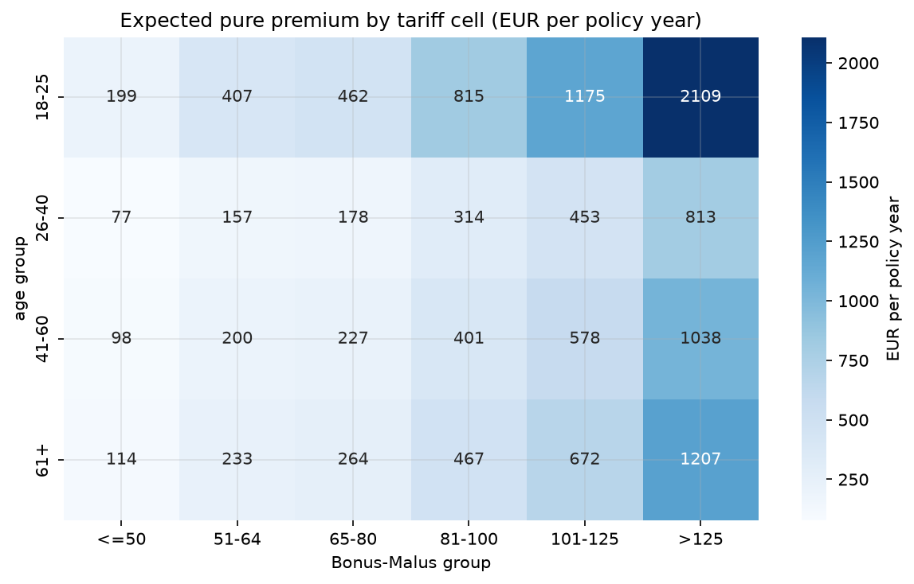

[🇬🇧 English](README.md) | [🇩🇪 Deutsch](README_DE.md)

# Insurance Pricing Analytics — Kfz-Haftpflichttarif mit Python und SQL

*Deutsche Fassung mit allen fachlichen Inhalten. Projektstruktur und Anleitung zum Ausführen
stehen in der [englischen README](README.md); das Projekt als Notebook mit allen Ergebnissen:
[`insurance_pricing_walkthrough.ipynb`](insurance_pricing_walkthrough.ipynb).*

Ein Pricing-Projekt auf einem öffentlichen französischen Kfz-Haftpflichtbestand (freMTPL2):
Schadenhäufigkeit und Schadenhöhe werden getrennt mit GLMs modelliert, zu einer Pure Premium
je Tarifzelle kombiniert und out-of-sample validiert. Python für die Modelle, SQL für
Datenqualität und Bestandsanalysen.

**Die Geschichte in einem Satz:** Mein erstes Modell hat den Schadenaufwand des Portfolios um
32 % überschätzt — die Ursache lag nicht im Modell, sondern in den Daten: Schadenzahl und
Schadenbeträge beschrieben nicht dieselben Schäden.

## Kernergebnisse

| | Ergebnis |
|---|---|
| **Datenkonsistenz** | Das erste Modell lag auf Portfolioebene **+31,9 %** daneben. Ursache: Ein Block von 9.387 reinen Schadenpolicen am Anfang des Datensatzes enthält 27,5 % aller Schadenzahlen, aber nur für 3 % davon gibt es einen Schadenbetrag. Nach der Bereinigung zählen Frequenz und Schadenhöhe dieselben 26.065 Schäden. |
| **Out-of-sample** | Basistarif (Alter × Bonus-Malus): Gini **0,254**, erklärte Deviance D² 3,99 % auf einem Testdatensatz. Erweiterter Tarif mit per Kreuzvalidierung ausgewählten Merkmalen: Gini **0,289**, D² 4,68 %. |
| **Großschäden** | Die 3 größten Schäden (alle Fahrer 18–20 Jahre) tragen 11,5 % des gesamten Schadenaufwands. Mit bei 50.000 € gekappten Schäden verschwindet der Schadenhöhen-Effekt junger Fahrer (Faktoren 0,92–0,96, nicht signifikant). Über 5 Folds schwankt der Portfoliofehler mit allen Schäden zwischen **−22 % und +18 %**, mit gekappten Schäden nur zwischen **−2,5 % und +2,3 %**. |
| **Schadenhöhenmodell** | Gamma-GLM vs. Lognormal (mit Bias-Korrektur σ²/2): gewichteter Fehler der Gruppenmittel 1,1 % vs. 14,6 % (Altersgruppen). Das Lognormal-Modell hat kleinere p-Werte — Signifikanz ist nicht dasselbe wie eine gute Schätzung des Erwartungswerts. |

  
  

*Links: Pure Premium je Tarifzelle (EUR je Versicherungsjahr). Rechts: Ein einzelner Schaden
von 4 Mio. € verschiebt die Portfolioprüfung eines Folds um rund 20 Prozentpunkte — deshalb
werden Großschäden gekappt und der Überschuss als Zuschlag umgelegt.*

## Daten und Datenbereinigung

freMTPL2 aus dem R-Paket CASdatasets, französische Kfz-Haftpflicht: `freMTPL2freq` mit
678.013 Policen (Exposure, Schadenzahl, Tarifmerkmale) und `freMTPL2sev` mit 26.639
Schadenbeträgen, verknüpft über die Policennummer. Französischer Bonus-Malus: 50 ist der beste
Wert (0,5 × Grundprämie), 100 der Startwert, über 100 ein Malus nach Schäden — umgekehrt zu den
deutschen SF-Klassen.

**Befunde der Konsistenzprüfung** (in Python und in SQL):

| Befund | Bedeutung |
|---|---|
| Summe der Schadenzahlen 36.102, aber nur 26.639 Schadenbeträge (Verhältnis 1,355) | Frequenz × Schadenhöhe passt nicht zum beobachteten Aufwand → Ursache der +31,9 % |
| Alle Policen vor der ersten schadenfreien Police (IDpol < 24.952) haben einen Schaden, nur 3 % davon mit Betrag, Jahresfrequenz 2,07 | Ein Block reiner Schadenpolicen, keine Stichprobe des Bestands; außerhalb passen Zahl und Betrag zu über 99,9 % |
| 195 Schäden ohne Police gehören zu nur 6 Policennummern mit je 21–66 Schäden; die Nachbarnummern existieren | Lücken im Policenbestand, vermutlich Flotten |
| 7 von 9 Policen mit mehr als 4 Schäden haben dasselbe Fahrerprofil | Flottenartige Risiken, keine Einzelrisiken |
| 1.224 Policen mit Exposure über 1 Jahr | Erfassungsfehler, Verträge laufen höchstens ein Jahr |

**Bereinigungsregeln:**

1. Den Block komplett ausschließen. Nur seine Schadenpolicen zu streichen würde die Frequenz
   nach unten verzerren, weil die schadenfreien Policen erhalten blieben.
2. Übrige Policen ausschließen, deren Schadenzahl nicht zur Zahl der Beträge passt.
3. Policen mit mehr als 4 Schäden ausschließen — ausschließen statt kappen, sonst stünden
   4 gezählte Schäden bis zu 16 Beträgen gegenüber.
4. Exposure auf 1 Jahr kappen.
5. Schäden ohne Police und Schäden ausgeschlossener Policen entfernen.

Ergebnis: 668.595 Policen, 353.540 Versicherungsjahre, 26.065 Schäden mit jeweils genau einem
Betrag; ausgeschlossen sind 1,4 % der Policen und 2,6 % des Schadenaufwands. Python- und
SQL-Bereinigung stimmen Police für Police überein (`check_sql_cleaning.py`).

## Methode

| Schritt | Was und warum | Datei |
|---|---|---|
| 1. Datenqualität | Schadenzahl gegen Schadenbeträge je Police, Lage des inkonsistenten Blocks per Window Function, Flotten-Policen per Self-Join | `data_prep.py`, SQL Kap. 1 |
| 2. Bereinigung | Regeln oben; in SQL als Tabellen mit Primär- und Fremdschlüsseln in einer Transaktion | `data_prep.py`, SQL Kap. 2 |
| 3. Schadenhäufigkeit | Poisson-GLM, Log-Link, `log(Exposure)` als Offset (Schäden je Versicherungsjahr) | `frequency.py` |
| 4. Schadenhöhe | Gamma-GLM (Log-Link) gegen Lognormal-Modell mit Bias-Korrektur σ²/2 | `severity.py` |
| 5. Tarif | Pure Premium = Frequenz × Schadenhöhe für 24 Tarifzellen (4 Alters- × 6 Bonus-Malus-Gruppen) | `pricing.py` |
| 6. Validierung | 80/20-Aufteilung mit festem Seed; Out-of-sample-Poisson-Deviance gegen Nullmodell, Lift-Chart, Gini; Negativ-Binomial-Test auf Overdispersion; Großschadenkappung bei 50.000 €; 5-Fold-Kreuzvalidierung des Portfoliofehlers | `validation.py` |
| 7. Tarifmerkmale | Vorwärtsauswahl per 5-Fold-Kreuzvalidierung **nur auf den Trainingsdaten** (Gewinn ≥ 0,1 % in jedem Fold), Testdaten nur einmal verwendet; Großschadenzuschlag pauschal gegen credibility-gewichtet; Tariftabellen über den Bestandsmix gemittelt | `features.py` |
| SQL | Indizes und Query Plans, Views für die Tarifbänder, Window Functions (RANK, ROW_NUMBER, LAG, gleitende Fenster, PERCENT_RANK, NTILE, Gini über die Lorenzkurve) | `policies_analysis.sql` |

## Weitere Erkenntnisse

- **Die In-sample-Portfolioprüfung zeigt Konsistenz, nicht Prognosegüte.** Die −0,79 % nach
  der Bereinigung entstehen fast konstruktionsbedingt; die Güte wird out-of-sample gemessen.
- **Overdispersion ist signifikant, aber klein** (Negativ-Binomial α = 0,87, Varianz rund 7 %
  über Poisson); sie betrifft Standardfehler, nicht die Prämie.
- **Bonus-Malus sagt voraus, wie oft, nicht wie teuer** ein Schaden ist.
- **Faktoren sind bedingt:** Bei gleichem Bonus-Malus haben 21- bis 30-Jährige *niedrigere*
  Frequenzfaktoren als 41- bis 50-Jährige — BM 100 heißt bei Jungen „Anfänger“, bei Älteren
  „hatte Schäden“. Nächster Schritt: Interaktion Alter × Bonus-Malus.
- **Credibility für Großschäden:** pauschal +29,6 % für alle, rein nach Altersgruppe wären es
  +157 % für 18–25 auf Basis von nur 14 Großschäden; credibility-gewichtet +44,8 %.

## Grenzen

Keine Datumsangaben (kein Trend, keine Abwicklung); der inkonsistente Datenblock, sechs
fehlende Policennummern und Bonus-Malus 50 bei 18-Jährigen müssten mit dem Datenlieferanten
geklärt werden; die Schadenhöhe ist mit den verfügbaren Merkmalen kaum vorhersagbar.

## Ausführen

Siehe [How to run](README.md#how-to-run) in der englischen README.

---

*Hinweis zur Transparenz:* Die ursprüngliche Analyse habe ich selbst erstellt. Die
Überarbeitung — die Ursachensuche für die 32 % Abweichung, die Out-of-sample-Validierung, die
Merkmalsauswahl, die SQL-Überarbeitung und die Aufteilung in Module — entstand mit einem
KI-Assistenten (Claude), dessen Commits in der Historie als solche gekennzeichnet sind. Ich habe
jeden Schritt geprüft, die Befunde an den Daten nachvollzogen und über das Vorgehen entschieden;
einzelne Befunde, etwa die sechs Policennummern hinter den nicht zuordenbaren Schäden, stammen
von mir.
